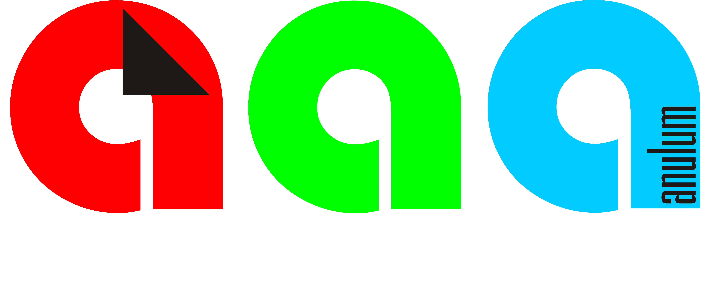

<!--
SPDX-License-Identifier: AGPL-3.0-or-later
Commercial license available
© Concepts 1996–2026 Miroslav Šotek. All rights reserved.
© Code 2020–2026 Miroslav Šotek. All rights reserved.
ORCID: 0009-0009-3560-0851
Contact: www.anulum.li | protoscience@anulum.li
NEURO-EVIDENCE-BENCH — repository governance and provenance
-->

# Benchmark repository tooling

This guide documents implemented local repository validators. Benchmark execution, metric assembly and independent rerun remain planned. No measured result or qualified scientific capability is declared.

NEURO-EVIDENCE-BENCH is part of the **SC Neuromorphic Computing Systems** group (SC-NEUROMORPHIC-COMPUTING-SYSTEMS). The [group and project map](https://github.com/anulum/sc-neurocore/blob/main/docs/ecosystem.md) shows the whole programme and where this repository sits in it.

The planned metric alignment acknowledges [NeuroBench](https://github.com/NeuroBench/neurobench). Its published definitions are reference targets; no NeuroBench code or dataset is incorporated and no current metric compatibility is certified.

Read the [tooling contract](validation-tooling.md), [component architecture](ARCHITECTURE.md), [trust boundaries](THREAT_MODEL.md) and [repository boundary](adr/0001-repository-boundary.md).

